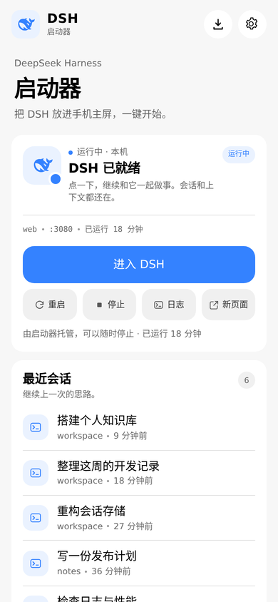
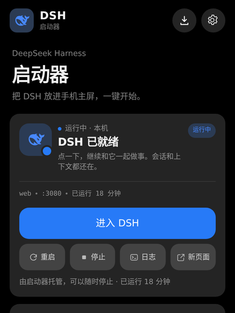
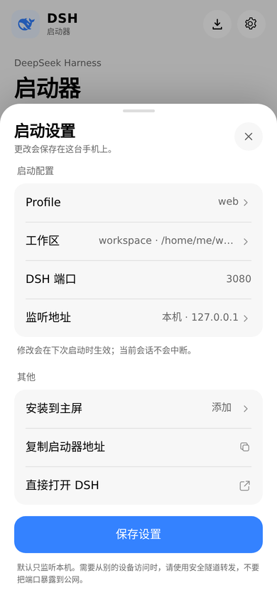

# DeepSeek Harness For Android

A mobile-first, **Miuix-styled launcher** for [DeepSeek Harness](https://github.com/deepseek-ai/deepseek-harness) (DSH).

> **Unofficial community project.** Not affiliated with, endorsed by, or sponsored by DeepSeek or Xiaomi.  
> This project is a **PWA launcher** with an optional thin APK WebView shell, not a standalone native DSH client and not an official DeepSeek client. It needs DSH running in a Linux userland on Android (Eta, Termux/proot, etc.).

[中文说明](README.zh.md)

| Light | Dark |
| --- | --- |
|  |  |



## Why

DSH is excellent on a desktop, but a phone usually means: open a terminal, start `dsh web`, copy the token URL, and keep it around. This project turns that into a one-tap home-screen app:

- starts or adopts a local `dsh web` instance;
- discovers the access token from DSH's own logs;
- embeds DSH in an app-like shell with a mobile-safe back button;
- bundles **dsh-web-mobile** for the mobile DSH UI and **dsh-ops** for native file/shell tools;
- clears DSH's persisted right-side document preview before entering, so a phone-width screen does not get stuck on a file diff;
- follows the system light/dark appearance with a Miuix visual language.

All data stays on the device. There is no telemetry, account, or external service.

## Features

- **One tap**: starts DSH if needed, or adopts the DSH already running on port 3080.
- **Token discovery**: reads the token printed in DSH logs; no manual copy/paste.
- **Embedded DSH**: opens DSH in a full-height iframe with a `启动器` back button and a `对话` reset button.
- **Bundled plugins**: ships pinned snapshots of **dsh-web-mobile** (mobile DSH UI) and **dsh-ops** (native file/shell tools), linked into the `web` profile automatically.
- **Back to chat bridge**: clears `dsh.sidebar-right.*` localStorage layouts when entering embedded DSH, so old file-preview tabs do not cover the chat.
- **Recent sessions**: reads DSH's local session projection cache and shows the six most recent titles, workspaces, and ages.
- **Profiles, workspace, port, bind address**: editable from the phone.
- **PWA**: installable to the home screen, service worker offline shell, standalone display.
- **APK shell**: an optional signed Android WebView wrapper that opens the local launcher.
- **Boot hook**: optional KernelSU `service.d` script to start the launcher after boot. It does not auto-start DSH.
- **Security defaults**: loopback-only by default, optional access key for non-loopback binds, token/API-key redaction in the log viewer.

## Requirements

- **Android with a Linux userland** such as Eta (Debian proot) or Termux. The boot hook included here is written for Eta + KernelSU, but the launcher itself is generic Linux.
- **Node.js 24+** (required by the bundled dsh-web-mobile plugin).
- **DSH 0.2.1+** installed and able to run the `web` profile.
- A modern Chromium-based browser for PWA installation (Chrome on Android; `127.0.0.1` is treated as a secure context).
- Root + KernelSU only if you want the optional Android boot hook.

## Quick start

```sh
git clone https://github.com/Meow1s/DeepSeek-Harness-For-Android.git
cd DeepSeek-Harness-For-Android
sh scripts/start.sh
```

Open:

```text
http://127.0.0.1:3081/
```

The launcher starts on port 3081. DSH itself defaults to port 3080. If DSH is already running, the launcher adopts it; otherwise press **启动并进入** and it will start `dsh web`.

### Android

1. Set up Eta (Debian) or Termux, install Node.js 24+ and DSH.
2. Clone this repository into the Linux userland.
3. Run `sh scripts/start.sh` once.
4. Open `http://127.0.0.1:3081/` in Chrome.
5. Use the download icon in the launcher or Chrome's **Add to Home screen / Install app**.

If your DSH installation is in a non-standard place, set `DSH_LAUNCHER_DSH_COMMAND` to the executable path before starting.

## Install as a PWA

The launcher ships a manifest, icons, and a service worker. On Chrome Android:

1. Open the launcher.
2. Tap the download icon in the top bar (or **Settings → 安装到主屏**).
3. If no prompt appears, use Chrome's menu → **Add to Home screen / Install app**.

The PWA is scoped to the launcher origin. If you open the launcher via `localhost`, DSH links use `localhost` too, keeping the DSH auth cookie same-site inside the iframe.

## Android APK

A signed APK is published on [GitHub Releases](https://github.com/Meow1s/DeepSeek-Harness-For-Android/releases/latest):

```text
dsh-launcher-1.0.1.apk
```

The APK is a **thin WebView shell** for the local launcher:

- it opens `http://127.0.0.1:3081/` in a full-screen WebView;
- it does **not** bundle Node, DSH, or the proot rootfs — start the launcher in
  Eta/Termux first;
- if the launcher is down, the native error screen offers **重试** and, on
  Root/KernelSU, **启动本地服务** (runs `/data/adb/service.d/dsh-launcher.sh`);
- package `com.meow1s.dshlauncher`, minSdk 26, targetSdk 34;
- launcher icon uses the official DSH whale mark.

Build it yourself from [android-app/README.md](android-app/README.md). The release
is signed with a local keystore; keep that key safe if you want to publish
updates.

## Bundled DSH plugins

The launcher ships two DSH plugins as pinned source snapshots under `plugins/`:

- **dsh-web-mobile 3.2.1** — the mobile DSH UI: top-left drawer button, mobile header, bottom sheets, safe-area handling, and touch-friendly composer controls. MIT, by [mexiaosqwq](https://github.com/mexiaosqwq/dsh-web-mobile).
- **dsh-ops 0.4.1** — native file and shell tools for DSH. MIT AND Apache-2.0, by [T-Auto](https://github.com/T-Auto/dsh-ops).

`scripts/install-plugins.sh` links both directories into the `web` profile with `dsh plugin add link:...` and makes sure they are listed in `dsh.profile.bundles`. The launcher's `start.sh` and Android boot hook run it best-effort. Restart DSH after installing or changing plugins; its client bundles load at server start.

```sh
sh scripts/install-plugins.sh
```

The mobile UI (including the drawer and account popover) is provided by dsh-web-mobile; there is no separate bottom navigation bar injected by this launcher. The snapshots are not git submodules; see [plugins/README.md](plugins/README.md) for versions, licenses, and update notes.

## Back-to-chat bridge

DSH persists the right-side document/diff layout in `localStorage` under keys starting with `dsh.sidebar-right.`. On a phone-width iframe, that saved panel can fill the screen and hide the chat.

The launcher serves a tiny same-origin bridge page from the DSH frontend:

```text
public/dsh-pocket-reset.html
    → copied into DSH's @deepseek-ai/dsh-web-frontend/dist/
```

When `/open` is loaded inside the launcher iframe, it redirects through this page. The page removes the saved right-sidebar layouts and redirects to the real DSH token URL. When opened in a normal top-level tab, it only forwards the token and leaves the saved layout alone.

Install or repair the bridge:

```sh
sh scripts/install-dsh-reset-page.sh
```

`scripts/start.sh` and the Android boot hook run this installer best-effort. If DSH is upgraded and the bridge file disappears, `/open` falls back to normal DSH behavior; re-run the installer to restore the reset behavior.

## Android boot hook (optional)

`android/dsh-launcher-boot.sh` is a KernelSU `service.d` example. It waits for boot and for Eta's Debian rootfs, then starts the launcher in a proot session. It **does not** start DSH automatically.

Copy it to the device (adapt the paths at the top first):

```sh
su -c 'cp android/dsh-launcher-boot.sh /data/adb/service.d/dsh-launcher.sh'
su -c 'chmod 755 /data/adb/service.d/dsh-launcher.sh'
```

The defaults target Eta at `/data/user/0/io.github.mangi.eta` and workspace `/data/local/tmp/eta`. Override `DSH_LAUNCHER_WORKSPACE`, `DSH_LAUNCHER_APP_DIR`, `DSH_LAUNCHER_DATA_HOST`, `DSH_LAUNCHER_HOST`, and `DSH_LAUNCHER_PORT` if your setup differs.

## Configuration

The settings sheet writes `data/config.json`:

```json
{
  "profile": "web",
  "workspace": "/home/me/workspace",
  "host": "127.0.0.1",
  "port": 3080
}
```

- `profile`: a DSH profile that includes `@deepseek-ai/dsh-web-app`.
- `workspace`: absolute directory DSH uses as its root.
- `host`: a concrete local IPv4 address. DSH rejects wildcard binds.
- `port`: DSH Web port.

Launcher port and bind address are controlled with CLI flags or environment variables:

```sh
node server.mjs --host 127.0.0.1 --port 3081
# or
DSH_LAUNCHER_PORT=3081 DSH_LAUNCHER_HOST=127.0.0.1 sh scripts/start.sh
```

Other environment variables:

| Variable | Purpose |
| --- | --- |
| `DSH_LAUNCHER_DATA` | Data directory (default `./data`) |
| `DSH_LAUNCHER_DSH_COMMAND` | DSH executable path |
| `DSH_LAUNCHER_ACCESS_KEY` | Access key when binding a non-loopback address |
| `DSH_WEB_FRONTEND_DIST` | Override the DSH frontend dist for the reset bridge installer |

## Security

- Defaults to `127.0.0.1` only.
- Binding a non-loopback address automatically creates `data/access-key` and requires a key-backed cookie.
- The DSH token is kept server-side and only appears in the `/open` redirect, never in `/api/status`.
- `/api/logs` redacts `token=…`, `sk-…`, and bearer tokens.
- Writes require a same-origin JSON POST.
- Do not expose ports 3080/3081 directly to the public internet. Use Tailscale, SSH forwarding, or another trusted tunnel.

## How it works

```text
PWA (3081)
  ├─ GET /api/status
  ├─ if no DSH instance:
  │    spawn: dsh --profile web --host 127.0.0.1 --port 3080 --no-open
  ├─ parse token from the child/known DSH logs
  ├─ validate token (DSH answers 303)
  ├─ GET /open
  │    └─ DSH-origin dsh-pocket-reset.html?token=…
  │         ├─ remove dsh.sidebar-right.* when embedded
  │         └─ redirect to /?token=…
  └─ iframe DSH with a 启动器 back button and a 对话 reset button
       └─ bundled dsh-web-mobile + dsh-ops loaded by the web profile
```

The launcher starts DSH detached so it survives a launcher restart. On restart, the launcher recovers ownership from `data/managed.json`. A DSH started outside the launcher is adopted read-only: it can be opened but not stopped from the launcher.

## API

| Method | Path | Description |
| --- | --- | --- |
| GET | `/api/status` | Launcher, DSH, config, recent sessions |
| GET | `/api/logs?lines=220` | Redacted log tail |
| POST | `/api/start` | Start managed DSH |
| POST | `/api/stop` | Stop managed DSH |
| POST | `/api/restart` | Restart managed DSH |
| POST | `/api/settings` | Save profile/workspace/port/host |
| POST | `/api/dismiss` | Clear the last error |
| GET | `/open` | Redirect through the reset bridge to tokenized DSH |
| GET | `/healthz` | Health check |

POST endpoints require `Content-Type: application/json` and same-origin.

## Testing

```sh
node --check server.mjs
node --check public/app.js
node --check public/sw.js
sh -n scripts/install-plugins.sh
sh -n android-app/build.sh
node test/smoke.mjs
```

The smoke test runs a mock DSH and exercises start, token discovery, `/open` redirect, redacted logs, stop, and settings. GitHub Actions runs the same test on Node 24.

Every change can be committed and pushed with:

```sh
sh scripts/sync-github.sh "feat: describe the change"
```

## Troubleshooting

**"找不到 DSH 访问令牌"** — DSH prints its token only at startup. The launcher scans `/workspace/daemon/dm_*.log`, `/workspace/dsh/*.log`, and its own `data/logs/dsh-*.log`. Restart DSH; for a managed instance use **重启** in the launcher.

**"端口已被占用"** — change the DSH port in settings or stop the process on 3080.

**Embedded page is blank** — use **新页面** or **直接打开 DSH**. If DSH adds an iframe-blocking header in the future, the embedded view will not work, but the new tab will.

**Still see a file diff/right panel after entering** — tap **对话** in the DSH top bar. To reinstall the bridge: `sh scripts/install-dsh-reset-page.sh`.

**Mobile UI is missing after an upgrade or restart** — check that the bundled plugins are linked: `sh scripts/install-plugins.sh`, then restart DSH (not just the browser). The mobile UI is a client plugin and only loads when the DSH server starts.

**PWA keeps old UI** — bump `VERSION` in `public/sw.js`, then reopen / clear site data. The service worker removes old caches.

**Android boot hook not running** — check `/data/adb/service.d/dsh-launcher.sh` and the boot log in `data/boot.log`. Paths are specific to Eta by default.

## Limitations

- The APK is a thin WebView shell; it does not bundle Node, DSH, or the proot rootfs.
- **dsh-web-mobile and dsh-ops are pinned third-party snapshots. Updating them requires replacing the directories and re-testing DSH compatibility. dsh-ops native runtime support is platform-specific.**
- A DSH instance started outside the launcher cannot be stopped/restarted by the launcher.
- The optional boot hook assumes Eta's paths and root/KernelSU; adapt it for other environments.
- PWA installation is available only in a secure context (`127.0.0.1` / HTTPS), not over plain LAN HTTP.

## Credits

- [DeepSeek Harness](https://github.com/deepseek-ai/deepseek-harness) by DeepSeek.
- [dsh-web-mobile](https://github.com/mexiaosqwq/dsh-web-mobile) by mexiaosqwq (MIT) — bundled mobile DSH UI.
- [dsh-ops](https://github.com/T-Auto/dsh-ops) by T-Auto (MIT AND Apache-2.0) — bundled native tools.
- [Miuix](https://github.com/compose-miuix-ui/miuix) design language; web tokens/component CSS from [miuix-vue](https://github.com/YuKongA/miuix-vue) (Apache-2.0).
- Miuix visual references are used descriptively. This project is independent and is not affiliated with Xiaomi, MIUI, or HyperOS.
- The DSH whale mark is used only to identify the local DSH launcher.

## License

MIT. See [LICENSE](LICENSE). The bundled Miuix CSS is Apache-2.0; see [public/vendor/miuix/LICENSE](public/vendor/miuix/LICENSE). Bundled plugins keep their own licenses under [plugins/](plugins/README.md).
