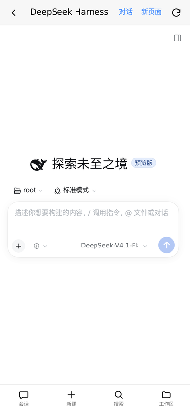
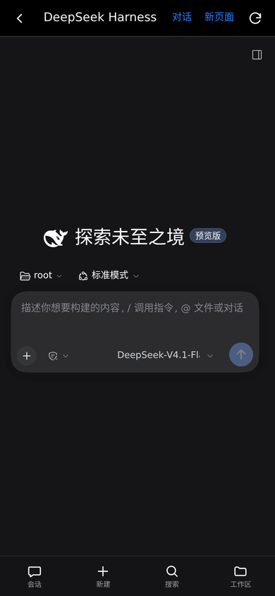

# DeepSeek Harness For Android

> 把 DeepSeek Harness 放到手机主屏的 Miuix 风格启动器。

[English](README.md)

| 浅色 | 深色 |
| --- | --- |
|  |  |


> **非官方社区项目。** 与 DeepSeek、小米均无隶属或背书关系。  
> 这是一个 **PWA 启动器**，不是原生 APK，也不是 DeepSeek 官方 Android 客户端。它需要 DSH 在 Android 的 Linux 用户空间（Eta、Termux/proot 等）中运行。

## 为什么

DSH 在桌面上很好用，但在手机上通常要打开终端、启动 `dsh web`、复制 token 链接。这个项目把它变成主屏上的一个 App：

- 自动启动或接管本地 `dsh web`；
- 从 DSH 日志自动找访问 token，不需要手工复制；
- 把 DSH 嵌进带返回键的手机壳里，提供「启动器」和「对话」按钮；
- 对 DSH 本身做手机宽度适配：全宽会话、底部导航、抽屉式侧栏、全屏工具面板；
- 进入时清掉 DSH 右侧文档预览 / 文件 diff 的旧布局，避免手机宽度下只剩一个 diff 面板；
- 跟随系统浅色 / 深色，使用 Miuix 视觉语言。

数据全部留在本机，没有遥测、账号或外部服务。

## 功能

- **一键启动并进入**：没有 DSH 时自动拉起 `dsh web`。
- **自动接管**：已经在 3080 运行的 DSH 会从日志找 token 接管。
- **内嵌 DSH**：全高 iframe，顶部「启动器」返回，另有「对话」复位按钮。
- **DSH 手机布局**：≤700px 时把左侧图标栏换成底部导航，侧栏改为抽屉，会话区占满全宽。
- **回到对话**：清除 `dsh.sidebar-right.*` 持久化布局，不再被 `preview.png` / 文件 diff 挡住。
- **最近会话**：读取 DSH 本地投影缓存，显示最近 6 个会话的标题、工作区和时间。
- **配置**：在手机上切换 Profile、工作区、端口、监听地址。
- **PWA**：可添加到主屏，Service Worker 离线壳，独立窗口显示。
- **开机自启**：可选 KernelSU `service.d` 钩子；只启动启动器，不自动启动 DSH。
- **安全默认值**：默认只监听回环地址；监听其它地址时要求访问密钥；日志会脱敏 token / API key。
- **零运行时 npm 依赖**：Node 标准库 + 内置的 Miuix CSS。

## 环境要求

- Android 上的 Linux 用户空间：Eta（Debian proot）、Termux/proot 等。仓库内的开机钩子默认按 Eta 编写，但启动器本身是通用 Linux 程序。
- Node.js 22+。
- 已安装 DSH 0.2.x，且 `web` profile 可用。
- Chrome 等 Chromium 浏览器用于安装 PWA；`127.0.0.1` 属于安全上下文。
- 可选：root + KernelSU，用于 Android 开机钩子。

## 快速开始

```sh
git clone https://github.com/Meow1s/DeepSeek-Harness-For-Android.git
cd DeepSeek-Harness-For-Android
sh scripts/start.sh
```

打开：

```text
http://127.0.0.1:3081/
```

启动器默认在 3081，DSH 默认在 3080。DSH 已在运行时启动器会直接接管；否则点「启动并进入」，它会启动 `dsh web`。

### 安装到手机主屏

1. 用手机 Chrome 打开 `http://127.0.0.1:3081/`。
2. 点右上角下载图标，或「设置 → 安装到主屏」。
3. 如果没弹出安装提示，打开 Chrome 菜单 →「添加到主屏幕 / 安装应用」。

如果通过 `localhost` 打开启动器，DSH 链接也会使用 `localhost`，让 iframe 内的认证 cookie 保持 same-site。

## DSH 移动端适配

DSH 的桌面布局在手机上仍会保留 56px 图标栏和 280px 侧栏；打开侧栏后，会话区只剩 110px。这个项目往 DSH 前端注入一层很小的移动端适配：

| DSH 手机版 · 浅色 | DSH 手机版 · 深色 |
| --- | --- |
|  |  |

**700px 及以下**：

- 隐藏左侧图标栏，中间会话区占满整个视口；
- 底部四项导航：**会话 / 新建 / 搜索 / 工作区**；
- 侧栏变成 86vw 的固定抽屉，背景加遮罩；选中会话后自动收起；
- 全屏右侧栏（文件、终端、任务）打开时隐藏底部导航；
- 输入框使用 16px 字号，底部导航适配 `env(safe-area-inset-bottom)`。

700px 以上完全不改桌面布局。注入的文件：

```text
public/dsh-mobile.css
public/dsh-mobile.js
    → DSH @deepseek-ai/dsh-web-frontend/dist/
```

安装或修复移动端适配 + 重置桥：

```sh
sh scripts/install-dsh-mobile.sh
```

`scripts/start.sh` 和 Android 开机钩子会尽力自动补装。DSH 升级可能替换自己的 `index.html`；如果底部导航消失，重新运行安装脚本即可。

## 回到对话桥

DSH 会把右侧文档预览 / diff 的布局存到以 `dsh.sidebar-right.` 开头的 localStorage 键里。手机宽度下恢复这个布局会占满页面，看起来像整个 DSH 变成了代码 diff。

启动器通过一个 DSH 同源的重置页解决：

```text
public/dsh-pocket-reset.html
    → 复制到 DSH 的 @deepseek-ai/dsh-web-frontend/dist/
```

在启动器 iframe 里打开 `/open` 时，会先经过这个页面，清掉右侧栏布局，再跳转到真正的 DSH token URL。直接在新标签页打开时它只转发 token，不会动已保存的布局。

安装或修复（和移动端适配同一个脚本）：

```sh
sh scripts/install-dsh-mobile.sh
```

如果只想要重置桥，也可以单独运行 `scripts/install-dsh-reset-page.sh`。DSH 升级后如果重置页消失，`/open` 会自动回退到普通进入方式；重新运行移动端安装脚本即可同时恢复两件东西。

## Android 开机自启（可选）

`android/dsh-launcher-boot.sh` 是一个 KernelSU `service.d` 示例：等系统启动、等 Eta Debian rootfs 可读，然后在 proot 中启动启动器。它 **不会** 自动启动 DSH。

复制到手机（先按自己的环境修改顶部路径）：

```sh
su -c 'cp android/dsh-launcher-boot.sh /data/adb/service.d/dsh-launcher.sh'
su -c 'chmod 755 /data/adb/service.d/dsh-launcher.sh'
```

默认目标为 Eta 的 `/data/user/0/io.github.mangi.eta` 和 workspace `/data/local/tmp/eta`。可通过 `DSH_LAUNCHER_WORKSPACE`、`DSH_LAUNCHER_APP_DIR`、`DSH_LAUNCHER_DATA_HOST`、`DSH_LAUNCHER_HOST`、`DSH_LAUNCHER_PORT` 覆盖。

## 配置

设置面板写入 `data/config.json`：

```json
{
  "profile": "web",
  "workspace": "/home/me/workspace",
  "host": "127.0.0.1",
  "port": 3080
}
```

- `profile`：包含 `@deepseek-ai/dsh-web-app` 的 Profile。
- `workspace`：DSH 工作区绝对路径。
- `host`：本机具体 IPv4 地址；DSH 不接受通配地址。
- `port`：DSH Web 端口。

启动器自己的端口和地址：

```sh
node server.mjs --host 127.0.0.1 --port 3081
# 或
DSH_LAUNCHER_PORT=3081 DSH_LAUNCHER_HOST=127.0.0.1 sh scripts/start.sh
```

其他环境变量：

| 变量 | 用途 |
| --- | --- |
| `DSH_LAUNCHER_DATA` | 数据目录，默认 `./data` |
| `DSH_LAUNCHER_DSH_COMMAND` | DSH 可执行文件路径 |
| `DSH_LAUNCHER_ACCESS_KEY` | 监听非回环地址时的访问密钥 |
| `DSH_WEB_FRONTEND_DIST` | 移动端适配 / 重置桥安装目标 DSH 前端 dist |

## 安全

- 默认只监听 `127.0.0.1`。
- 监听非回环地址时自动生成 `data/access-key`，要求带密钥的 Cookie。
- DSH token 只留在服务端和 `/open` 跳转中，不出现在 `/api/status`。
- `/api/logs` 会脱敏 `token=…`、`sk-…` 和 Bearer token。
- 写接口要求同源 JSON POST。
- 不要把 3080 / 3081 直接暴露到公网；远程访问请用 Tailscale / SSH 隧道等。

## 工作原理

```text
PWA (3081)
  ├─ GET /api/status
  ├─ 没有 DSH：spawn dsh --profile web --host 127.0.0.1 --port 3080 --no-open
  ├─ 从日志解析 token
  ├─ 校验 token（DSH 返回 303）
  ├─ GET /open
  │    └─ DSH 同源 dsh-pocket-reset.html?token=…
  │         ├─ iframe 内清掉 dsh.sidebar-right.*
  │         └─ 跳转到 /?token=…
  └─ iframe 内嵌 DSH，顶部「启动器」/「对话」
       └─ ≤700px 时 dsh-mobile.css/js：底部导航 + 抽屉侧栏
```

启动器拉起的 DSH 以 detached 进程组运行，启动器停止后 DSH 仍可用；下次启动会从 `data/managed.json` 恢复托管关系。外部启动的 DSH 只能打开，不能在启动器内停止/重启。

## API

| 方法 | 路径 | 说明 |
| --- | --- | --- |
| GET | `/api/status` | 启动器、DSH、配置、最近会话 |
| GET | `/api/logs?lines=220` | 脱敏日志尾部 |
| POST | `/api/start` | 启动托管 DSH |
| POST | `/api/stop` | 停止托管 DSH |
| POST | `/api/restart` | 重启托管 DSH |
| POST | `/api/settings` | 保存 Profile/工作区/端口/地址 |
| POST | `/api/dismiss` | 清除错误 |
| GET | `/open` | 经重置桥 302 到带 token 的 DSH |
| GET | `/healthz` | 健康检查 |

## 测试

```sh
node --check server.mjs
node --check public/app.js
node --check public/sw.js
node --check public/dsh-mobile.js
sh -n scripts/install-dsh-mobile.sh
node test/smoke.mjs
```

Smoke 测试使用 mock DSH，完整跑一遍启动 → 找 token → `/open` 302 → 脱敏日志 → 停止 → 保存设置。GitHub Actions 在 Node 22 / 24 上运行同一套测试。

每次改动都可以用下面的脚本提交并推送：

```sh
sh scripts/sync-github.sh "feat: 描述这次改动"
```

## 故障排查

**提示「找不到 DSH 访问令牌」** — 重启 DSH。启动器会扫描 `/workspace/daemon/dm_*.log`、`/workspace/dsh/*.log` 和自己的 `data/logs/dsh-*.log`。托管实例可直接点「重启」。

**提示「端口已被占用」** — 改设置里的 DSH 端口，或停止 3080 上的进程。

**嵌入页空白** — 点「新页面」或设置里的「直接打开 DSH」。如果 DSH 未来禁止 iframe，嵌入会失效，但新标签页仍可用。

**进入后仍是文件 diff / 右侧栏** — 点 DSH 顶栏的「对话」。需要重装移动端适配和重置桥时运行 `sh scripts/install-dsh-mobile.sh`。

**DSH 升级后底部导航消失** — 重新运行 `sh scripts/install-dsh-mobile.sh`。DSH 升级会替换自己的前端 `index.html`。

**PWA 一直是旧界面** — 把 `public/sw.js` 的 `VERSION` 加一，然后重新打开 / 清除站点数据。

**开机后没有启动器** — 检查 `/data/adb/service.d/dsh-launcher.sh` 和 `data/boot.log`；默认路径按 Eta 写的，其它环境需要改。

## 已知限制

- 不是原生 Android APK，是本地 PWA 壳。
- 移动端适配通过注入 CSS 和一小段 DOM 导航实现，不是 DSH 的分支；DSH 升级后可能需要重跑安装脚本。
- 外部启动的 DSH 不能在启动器内停止/重启。
- Android 开机钩子默认依赖 Eta 路径和 root/KernelSU。
- PWA 安装只在安全上下文（127.0.0.1 / HTTPS）可用，普通局域网 HTTP 不行。

## 致谢

- [DeepSeek Harness](https://github.com/deepseek-ai/deepseek-harness)。
- [Miuix](https://github.com/compose-miuix-ui/miuix) 设计语言；Web tokens / 组件 CSS 来自 [miuix-vue](https://github.com/YuKongA/miuix-vue)（Apache-2.0）。
- Miuix 视觉仅作风格参考；本项目与小米、MIUI / HyperOS 无隶属或背书关系。
- DSH 鲸鱼标志仅用于标识本地 DSH 启动器。

## License

MIT，见 [LICENSE](LICENSE)。内置 Miuix CSS 为 Apache-2.0，见 [public/vendor/miuix/LICENSE](public/vendor/miuix/LICENSE)。
